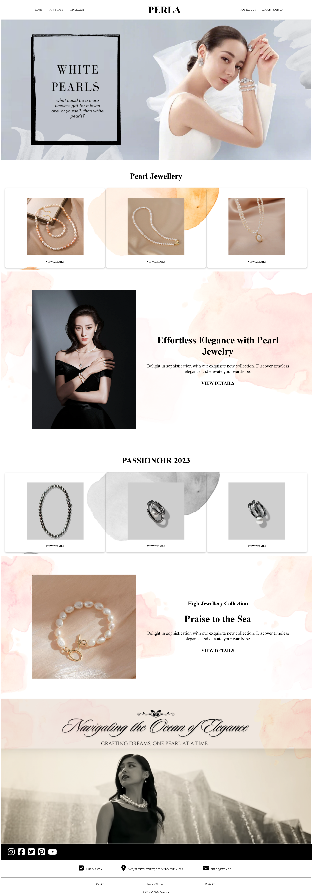
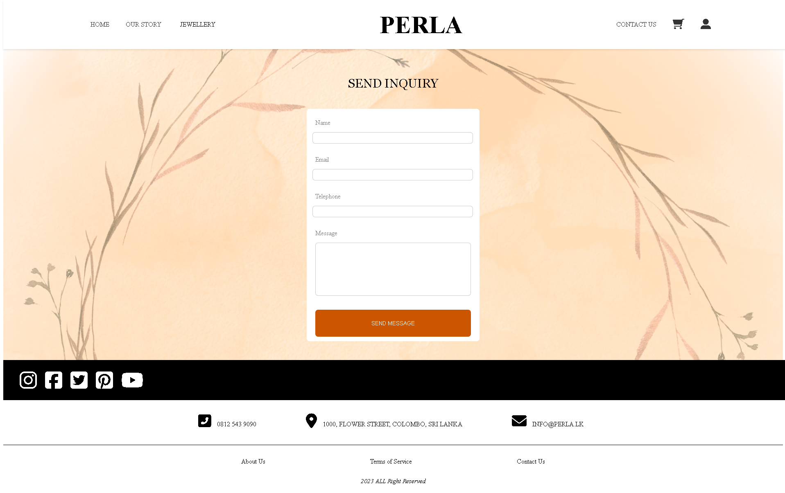
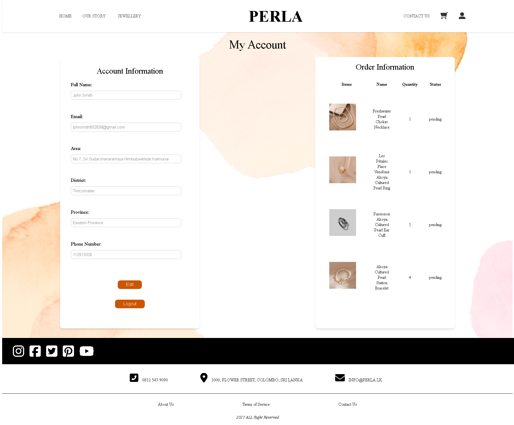
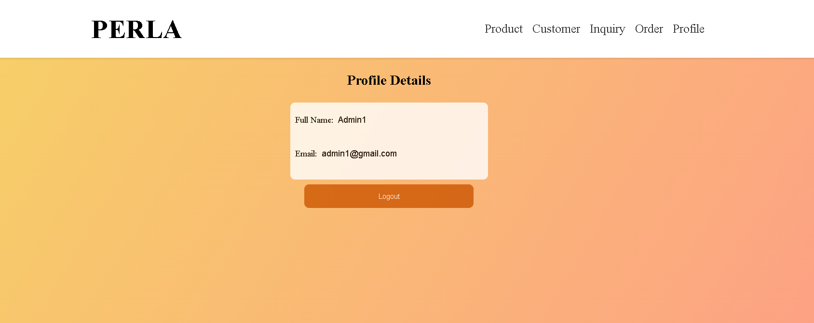

<div align="center">

# PERLA

### Pearl Jewellery E-Commerce Website

A PHP and MySQL web application featuring a pearl jewellery storefront, customer accounts, shopping-cart and order workflows, and an administration area.



**Customer Storefront · Shopping Cart · Order Management · Admin Tools**

</div>

---

## Overview

**Perla** is a pearl jewellery e-commerce website project. Customers can explore a jewellery catalogue, view product information, create an account, manage a shopping cart, and submit enquiries. The application also includes an administration area for managing products, customers, enquiries, and orders.

The repository contains PHP application pages, CSS stylesheets, JavaScript files, image assets, and interface screenshots.

## Features

### Customer storefront

- Browse the jewellery catalogue.
- Filter products by category.
- View individual product details.
- Register and log in to a customer account.
- View customer profile and edit profile information.
- Add products to a shopping cart.
- Update cart quantities and remove cart items.
- Continue from the cart to create order records.
- View order-related information through the customer profile.
- Submit enquiries through the contact form.
- View the About page and terms/privacy information.

### Administration

- View the product catalogue in the admin area.
- Add, update, and delete product records.
- View customer information and customer profiles.
- Update customer status.
- Review customer enquiries and update their replied status.
- View orders, update delivery status, and delete order records.
- View the administrator profile.

> **Payment scope:** The cart contains a checkout action that creates order records and clears the cart. The supplied code does not show a payment gateway or online payment processing integration. Do not treat placing an order as proof that payment has been collected.

## Screenshots

The screenshots below are stored in the repository and show the current application interface.

### Customer experience

#### Homepage


#### About Perla


#### Jewellery catalogue


#### Product details


#### Shopping cart


#### Account pages

| Login | Registration |
|---|---|
|  |  |

#### Contact and enquiries



### Administration

#### Product management


#### Add a product


#### Update products


#### Customer management


#### Customer profile



#### Enquiry management


#### Order management


#### Administrator profile



## Technology Stack

| Area | Technology |
|---|---|
| Back end | PHP |
| Database | MySQL / MySQLi |
| Front end | HTML, CSS, JavaScript |
| Local web server | Apache |
| Suggested local environment | XAMPP |

## Project Structure

```text
Perla/
├── css/                         # Page and shared stylesheets
├── database/
│   └── perla.sql                # Intended database export (see setup note)
├── docs/
│   └── screenshots/
│       ├── customer/            # Storefront and customer-page screenshots
│       └── admin/               # Administration-page screenshots
├── images/                      # Product and website image assets
├── js/                          # Client-side JavaScript
├── AboutUs.php
├── AdminCustomer.php
├── AdminInquiry.php
├── AdminOrder.php
├── AdminProduct.php
├── AdminProductAdd.php
├── AdminProductUpdate.php
├── AdminProfile.php
├── Cart.php
├── config.php                   # MySQL connection settings
├── ContactUs.php
├── EditUserProfile.php
├── Homepage.php
├── LoginProcess.php
├── LogOut.php
├── ProductDetails.php
├── Products.php
├── Profile.php
├── Register.php
├── Terms&privacy.html
└── README.md
```

## Getting Started

### Prerequisites

Install a local PHP and MySQL environment, such as [XAMPP](https://www.apachefriends.org/), with:

- Apache
- PHP with the MySQLi extension
- MySQL or MariaDB
- phpMyAdmin (optional)

### 1. Clone the repository

```bash
git clone https://github.com/JanudiRisaka/Perla.git
```

Move the project folder into the web server document root. With a standard XAMPP installation, this is usually `htdocs`.

### 2. Prepare the database

The application code expects a MySQL database named `perla`. However, **the `database/perla.sql` file in the supplied repository currently contains README Markdown rather than SQL statements**. It cannot be imported as a database dump.

Before running the application, obtain a valid database export from the original development database, or recreate the schema based on the queries and fields used by the PHP pages. Then import that valid SQL file into a database named `perla`.

The PHP code references tables including `tbluser`, `tbladmin`, `tblproduct`, `tblcart`, `tblorder`, and `tblfaq`. Their complete schema, keys, constraints, and seed data cannot be confirmed from the supplied `perla.sql` file.

### 3. Configure the database connection

Update `config.php` with the credentials for your local MySQL server.

The current file is configured for:

```php
$servername = "localhost";
$username = "root";
$password = "";
$db = "perla";
```

These are local development defaults, not credentials that will work in every environment. Do not commit real passwords or production credentials.

### 4. Run the application

Start Apache and MySQL, then open:

```text
http://localhost/Perla/Homepage.php
```

Adjust the URL if your project folder has a different name.

## Main Application Pages

| Page | Purpose |
|---|---|
| `Homepage.php` | Storefront homepage |
| `Products.php` | Product catalogue and category filtering |
| `ProductDetails.php` | Individual product information and add-to-cart action |
| `Register.php` | Customer registration |
| `LoginProcess.php` | Customer and administrator login |
| `Profile.php` | Customer profile and order-related information |
| `EditUserProfile.php` | Customer profile editing |
| `Cart.php` | Cart management and order submission |
| `ContactUs.php` | Customer enquiry submission |
| `AdminProduct.php` | Product administration |
| `AdminCustomer.php` | Customer administration |
| `AdminInquiry.php` | Enquiry administration |
| `AdminOrder.php` | Order and delivery-status administration |
| `AdminProfile.php` | Administrator profile |

## Demo Video

A project walkthrough video can be added here once it has been recorded.

**Video:** Coming soon

Suggested recording structure:

1. Introduce Perla and the storefront.
2. Browse the jewellery catalogue and open a product.
3. Demonstrate customer registration or login using a test account.
4. Add an item to the cart and demonstrate the order-submission flow.
5. Show the administration area and its product, customer, enquiry, and order management pages.

Do not show real passwords, private customer details, or sensitive database information in the recording.

## Known Limitations and Security Considerations

This repository represents a project implementation and should not be considered production-ready without further review.

Code inspection identified areas that need attention:

- **Password storage:** The registration and login code handles passwords as plaintext. Use `password_hash()` and `password_verify()` and migrate any existing test accounts appropriately.
- **SQL injection risk:** Several queries interpolate request or session values directly into SQL. Use prepared statements for all queries that include variable data.
- **Authorization:** Review every administration endpoint to ensure that administrator-only actions are protected by server-side session checks.
- **Input validation:** Validate and constrain submitted values on the server, including product fields, profile data, and contact-form submissions.
- **Output escaping:** Escape untrusted data before rendering it into HTML.
- **CSRF protection:** Add CSRF tokens to forms that change account, product, cart, enquiry, or order data.
- **Error handling:** Avoid exposing raw database errors to application users.
- **Database integrity:** Review foreign keys, constraints, cart/order consistency, and product stock handling.
- **Payment processing:** No payment gateway integration was identified in the supplied code.

## Future Improvements

- Restore and document a valid database export.
- Improve authentication and session security.
- Use prepared statements consistently.
- Add server-side validation and safer file-upload handling.
- Add CSRF protection and consistent authorization checks.
- Improve responsive behaviour and accessibility.
- Add automated tests for customer and administrator workflows.
- Document the database schema and order lifecycle.
- Integrate a payment provider if online payments are part of the intended scope.

---

<div align="center">

**PERLA** · Pearl Jewellery E-Commerce Website

</div>
