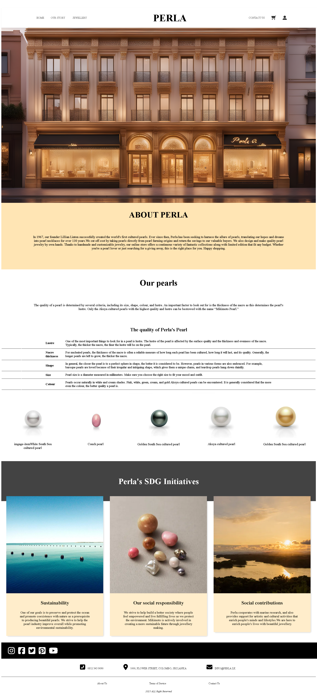
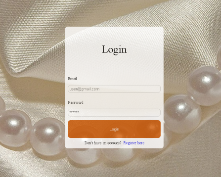
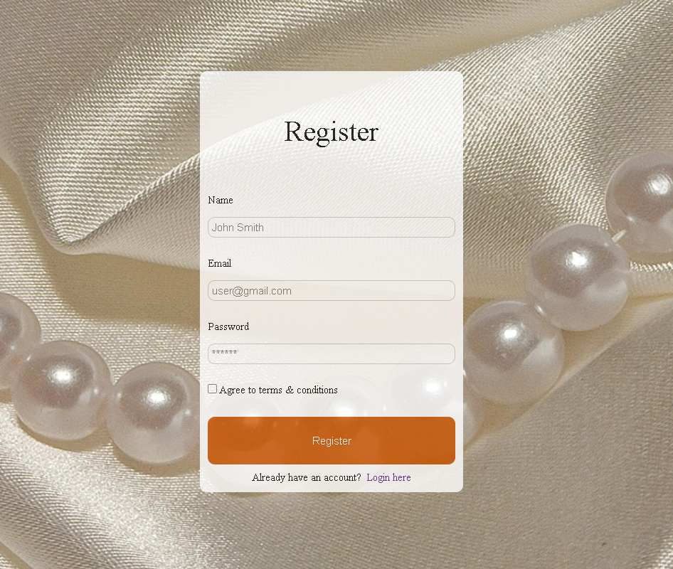
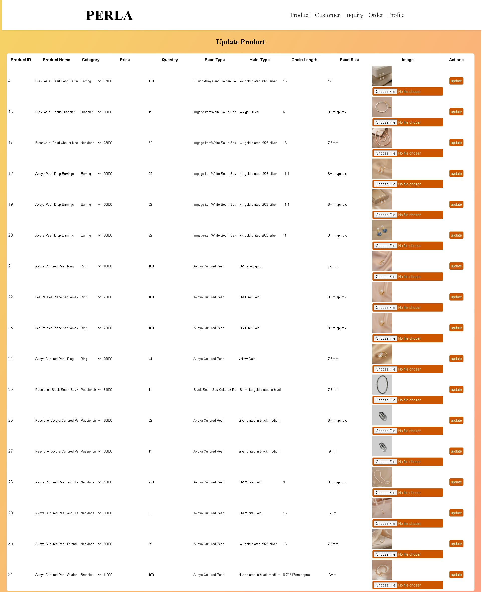
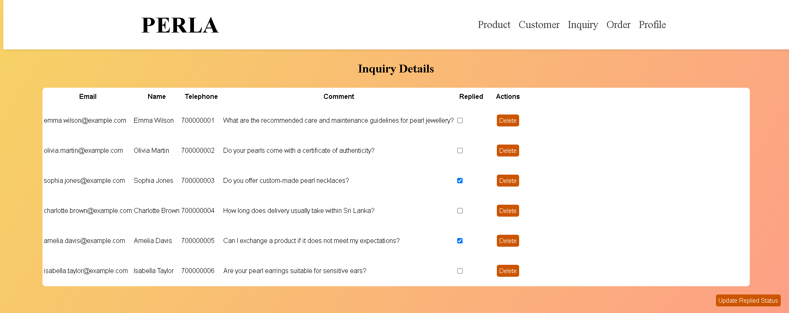
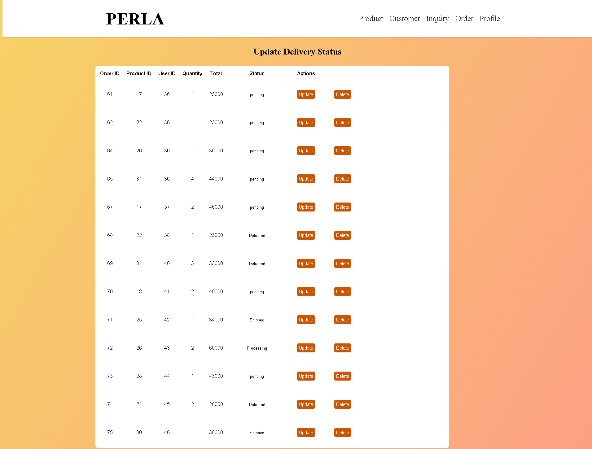

<div align="center">

# PERLA

### Pearl Jewellery E-Commerce Website

A PHP and MySQL web application developed as a university academic project, featuring a pearl jewellery storefront, customer accounts, shopping-cart and order workflows, and an administration area.

**Customer Storefront · Shopping Cart · Order Management · Admin Tools**

</div>

---

## Overview

**Perla** is a pearl jewellery e-commerce website developed as a university academic project. The application was built using PHP and MySQL to demonstrate the development of a database-driven web application.

The project includes a customer-facing storefront and an administration area. Customers can browse jewellery, manage shopping carts, and place orders, while administrators can manage products, customers, enquiries, and orders.

The project provided practical experience in PHP development, database integration, CRUD operations, session management, and building functional web interfaces.

## Features

### Customer storefront

- Browse the jewellery catalogue.
- Filter products by category.
- View individual product details.
- Register and log in to a customer account.
- View and edit customer profile information.
- Add products to a shopping cart.
- Update cart quantities and remove cart items.
- Proceed from the cart to submit orders.
- View order-related information through the customer profile.
- Submit enquiries through the contact form.
- View the About page and terms/privacy information.

### Administration

- View the product catalogue in the admin area.
- Add, update, and delete product records.
- View customer information and customer profiles.
- Update customer status.
- Review customer enquiries and update their replied status.
- View orders, update delivery status, and delete order records.
- View the administrator profile.

> **Payment:** Customers can add products to their cart and place orders through the checkout process. Online payment integration was not implemented because it was outside the scope of this university project.

## Screenshots

The screenshots below are stored in the repository and show the application's customer-facing and administration interfaces.

### Customer experience

#### Homepage


#### About Perla



#### Jewellery catalogue


#### Product details


#### Shopping cart


#### Account pages

| Login | Registration |
|---|---|
|  |  |

#### Contact and enquiries


### Administration

#### Product management


#### Add a product


#### Update products



#### Customer management


#### Customer profile


#### Enquiry management



#### Order management



#### Administrator profile


## Technology Stack

| Area | Technology |
|---|---|
| Back end | PHP |
| Database | MySQL / MySQLi |
| Front end | HTML, CSS, JavaScript |
| Local web server | Apache |
| Suggested local environment | XAMPP |

## Project Structure

```text
Perla/
├── css/                         # Page and shared stylesheets
├── database/
│   └── perla.sql                # MySQL database export
├── docs/
│   └── screenshots/
│       ├── customer/            # Storefront and customer-page screenshots
│       └── admin/               # Administration-page screenshots
├── images/                      # Product and website image assets
├── js/                          # Client-side JavaScript
├── AboutUs.php
├── AdminCustomer.php
├── AdminInquiry.php
├── AdminOrder.php
├── AdminProduct.php
├── AdminProductAdd.php
├── AdminProductUpdate.php
├── AdminProfile.php
├── Cart.php
├── config.example.php           # Example MySQL connection settings
├── ContactUs.php
├── EditUserProfile.php
├── Homepage.php
├── LoginProcess.php
├── LogOut.php
├── ProductDetails.php
├── Products.php
├── Profile.php
├── Register.php
├── Terms&privacy.html
└── README.md
```

`config.php` is created locally during setup and is not included in the repository.

## Getting Started

### Prerequisites

Install [XAMPP](https://www.apachefriends.org/), which provides the Apache web server, PHP, and MySQL/MariaDB. You will also need Git to clone the repository.

### 1. Clone the repository

```bash
git clone https://github.com/JanudiRisaka/Perla.git
```

Move the cloned `Perla` folder into the XAMPP web server document root, usually `C:\xampp\htdocs\`.

Your project directory should look like this:

```text
C:\xampp\htdocs\
└── Perla\
```

If you clone the repository directly inside `C:\xampp\htdocs\`, you do not need to move the folder.

### 2. Start Apache and MySQL

1. Open the XAMPP Control Panel.
2. Start **Apache**.
3. Start **MySQL**.
4. Confirm that both services are running.

### 3. Create and import the database

The application requires a MySQL database named `perla`. The repository includes a database export at `database/perla.sql`, containing the required table structures and fictional demonstration data.

To import it using phpMyAdmin:

1. Open [phpMyAdmin](http://localhost/phpmyadmin/).
2. Create a database named `perla`.
3. Select the `perla` database.
4. Open the **Import** tab.
5. Choose the `database/perla.sql` file from the cloned project.
6. Click **Import** or **Go** to execute the SQL file.

The database export includes these tables:

- `tbluser`
- `tbladmin`
- `tblproduct`
- `tblcart`
- `tblorder`
- `tblcontain`
- `tblfaq`

### 4. Configure the database connection

The repository includes `config.example.php`, which provides an example database connection configuration.

1. Copy `config.example.php`.
2. Rename the copied file to `config.php`.
3. Open `config.php`.
4. Update the database credentials to match your local MySQL configuration.
5. Save the file.

For a standard local XAMPP installation, the database settings are commonly:

| Setting | Typical local value |
|---|---|
| Host | `localhost` |
| Username | `root` |
| Password | *(empty by default)* |
| Database | `perla` |

Use the credentials configured on your own machine if they differ.

> **Configuration note:** `config.php` contains local database settings and is excluded from Git tracking. Only `config.example.php` is included in the repository. Do not commit real passwords or private configuration values.

### 5. Run the application

Make sure Apache and MySQL are running, then open:

```text
http://localhost/Perla/Homepage.php
```

The Perla homepage should now be accessible locally. If you used a different project folder name, adjust the URL accordingly.

## Admin Login

The database export includes a demonstration administrator account:

| Field | Demonstration value |
|---|---|
| Email | `admin1@gmail.com` |
| Password | `J72J4g4Pf5` |

These credentials are intended for local demonstration of the academic project. Do not reuse this password for any personal or external account. The application should not be treated as production-ready authentication software.

## Main Application Pages

| Page | Purpose |
|---|---|
| `Homepage.php` | Storefront homepage |
| `Products.php` | Product catalogue and category filtering |
| `ProductDetails.php` | Individual product information and add-to-cart action |
| `Register.php` | Customer registration |
| `LoginProcess.php` | Customer and administrator login processing |
| `Profile.php` | Customer profile and order-related information |
| `EditUserProfile.php` | Customer profile editing |
| `Cart.php` | Cart management and order submission |
| `ContactUs.php` | Customer enquiry submission |
| `AdminProduct.php` | Product administration |
| `AdminCustomer.php` | Customer administration |
| `AdminInquiry.php` | Enquiry administration |
| `AdminOrder.php` | Order and delivery-status administration |
| `AdminProfile.php` | Administrator profile |

## Known Limitations and Security Considerations

As an academic project, Perla was developed to demonstrate fundamental web development concepts and e-commerce functionality within the scope of the university assignment.

Some areas could be further improved to meet modern production-level security, performance, scalability, and usability standards. The following limitations and potential improvements are documented for future reference.

### 1. Security and Authentication

| Area | Current limitation | Recommended improvement |
|---|---|---|
| Password storage | Passwords are stored in plaintext. | Implement secure password hashing using `password_hash()` and `password_verify()`. |
| SQL injection | Some queries directly incorporate user input. | Use prepared statements for all database queries involving variable data. |
| Session management | Session security requires improvement. | Implement secure session handling, session regeneration, and appropriate expiration. |
| Admin authorization | Administrative access controls require further review. | Enforce server-side authorization checks on every admin endpoint. |
| Input validation | User input validation is limited. | Implement comprehensive server-side validation. |
| XSS protection | User-generated content requires safer output handling. | Escape dynamic content before displaying it in HTML. |
| CSRF protection | Forms require additional protection. | Implement CSRF tokens for state-changing requests. |
| File uploads | File-upload security requires improvement. | Validate file types, extensions, sizes, and uploaded content. |

### 2. Database and Data Management

| Area | Current limitation | Recommended improvement |
|---|---|---|
| Database relationships | Database relationships require further review. | Introduce appropriate foreign keys and constraints. |
| Data integrity | Data consistency needs improvement. | Use database transactions for related operations. |
| Error handling | Database errors require safer handling. | Log technical errors without exposing sensitive details to users. |
| Data validation | Database inputs require additional validation. | Validate data before inserting or updating records. |
| Database backups | No automated backup functionality is implemented. | Introduce a regular database backup strategy. |

### 3. E-Commerce Functionality

| Area | Current limitation | Recommended improvement |
|---|---|---|
| Online payments | Payment integration was outside the project scope. | Consider integrating a payment gateway if the project scope expands. |
| Order processing | Order workflows provide basic functionality. | Improve order validation and lifecycle management. |
| Inventory management | Stock management requires further development. | Implement real-time stock tracking and availability checks. |
| Shopping cart | Cart functionality can be further improved. | Improve cart persistence and quantity validation. |
| Order tracking | Delivery status management is available. | Introduce more detailed order tracking and status history. |
| Product management | Basic product management functionality is available. | Improve product categorization, search, and filtering. |

### 4. User Interface and User Experience

- **Responsive design:** Further improve layouts for mobile phones, tablets, and different screen sizes.
- **Accessibility:** Improve keyboard navigation, form labels, image descriptions, and colour contrast.
- **Navigation:** Improve consistency and usability across customer and administrator pages.
- **Form feedback:** Provide clearer validation messages and success/error notifications.
- **Loading states:** Introduce appropriate loading indicators for operations that take time.
- **Visual consistency:** Standardize typography, spacing, buttons, colours, and interface components.

### 5. Performance and Reliability

- **Code organization:** Improve code reusability and separate application logic from presentation.
- **Database performance:** Optimize queries and introduce appropriate database indexes.
- **Error handling:** Implement consistent application-level error handling.
- **Maintainability:** Reduce duplicated code and adopt a more structured project organization.
- **Scalability:** Improve the application architecture to support future functionality and increased usage.

### 6. Testing and Quality Assurance

- **Unit testing:** Introduce tests for individual application functions.
- **Integration testing:** Verify interactions between PHP components and the MySQL database.
- **Functional testing:** Test customer registration, login, product browsing, cart operations, and order workflows.
- **Admin testing:** Verify product, customer, enquiry, and order management operations.
- **Security testing:** Test authentication, authorization, input validation, and common web vulnerabilities.
- **Cross-browser testing:** Verify application behaviour across different browsers and devices.

> **Note:** The items above describe identified limitations and potential improvements. Recommended improvements have not necessarily been implemented or tested.

## Potential Future Enhancements

The project could be extended with features such as:

- Secure online payment integration.
- Improved product search and filtering.
- Inventory and stock management.
- More detailed order tracking.
- Enhanced responsive design and accessibility.
- Automated testing and stronger security controls.

---

<div align="center">

**PERLA** · Pearl Jewellery E-Commerce Website

</div>
